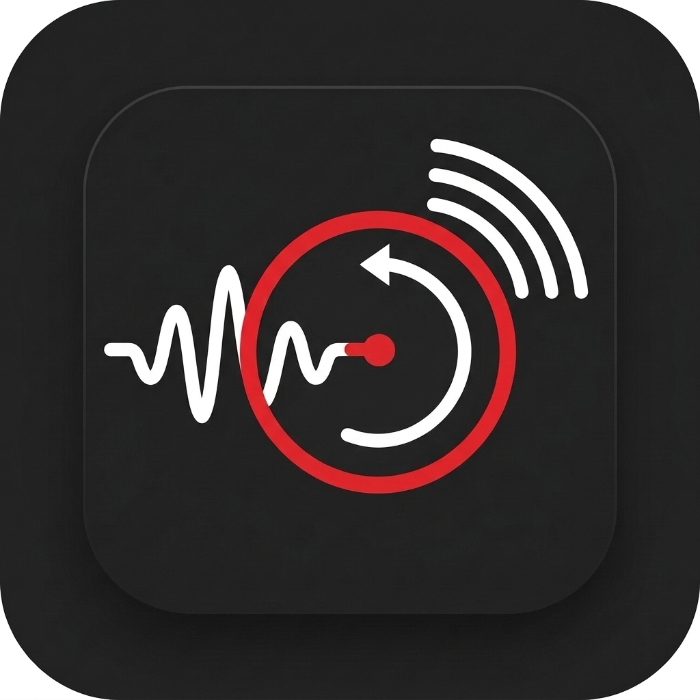

<p align="center">
  
</p>

# ORF Sound Timeshift Radio for Home Assistant

[](https://github.com/hacs/default)

Eine Home Assistant Custom Integration für das zeitversetzte Abspielen der österreichischen **ORF-Radiosender** (Hitradio Ö3, Radio Ö1, FM4 und alle 9 Bundesland-Sender) über das offizielle **7-Tage-Archiv (APA Loopstream)**.

---

## ✨ Features

- **Sekundengenauer Timeshift:** Starte Radiosendungen zu jedem beliebigen Zeitpunkt der letzten 7 Tage.
- **Natürliche Zeitangaben:** Unterstützt Angaben wie `"Sonntag 6:00 Uhr"`, `"Sonntag 06:00"`, `"gestern 18:00"`, `"06:00"` oder ISO-Datumsformate.
- **Volle Player-Kompatibilität:**
  - 🎵 **Yamaha MusicCast** (nativ via `media_player.play_media`)
  - 🎶 **Music Assistant** (`media_player.mass_...`)
  - 🔊 Sonos, Google Cast, HomePod / AirPlay, DLNA, ESPHome, Browser
- **Metadaten-Anzeige:** Übermittelt Sendungstitel, Moderator und Sendername direkt an das Display Ihres Endgeräts.
- **HACS-kompatibel:** Einfache Installation und Updates über HACS.

---

## 📻 Unterstützte Radiosender

| Stations-Kürzel | Sendername | APA Loopstream Channel |
|---|---|---|
| `oe3` | **Hitradio Ö3** | `oe3` |
| `oe1` | **Radio Ö1** | `oe1` |
| `fm4` | **Radio FM4** | `fm4` |
| `wie` | **Radio Wien** | `oe2w` |
| `noe` | **Radio Niederösterreich** | `oe2n` |
| `ooe` | **Radio Oberösterreich** | `oe2o` |
| `sbg` | **Radio Salzburg** | `oe2s` |
| `ktn` | **Radio Kärnten** | `oe2k` |
| `stm` | **Radio Steiermark** | `oe2st` |
| `tir` | **Radio Tirol** | `oe2t` |
| `vbg` | **Radio Vorarlberg** | `oe2v` |
| `bgl` | **Radio Burgenland** | `oe2b` |

---

## 📦 Installation

### Über HACS (Empfohlen)

1. Öffne **HACS** in Home Assistant.
2. Gehe auf **Integrationen** -> Klicke oben rechts auf die drei Punkte -> **Benutzerdefinierte Repositories**.
3. Füge die URL dieses Repositories ein und wähle die Kategorie **Integration**.
4. Klicke auf **Herunterladen**.
5. Starte Home Assistant neu.

### Manuelle Installation

1. Kopiere den Ordner `custom_components/orf_sound` in Dein Home Assistant Verzeichnis `/config/custom_components/`.
2. Starte Home Assistant neu.

---

## 🛠️ Verwendung in Automationen

Die Integration registriert den Dienst `orf_sound.play_timeshift`.

### Beispiel 1: Jeden Montag den Ö3-Wecker vom Sonntag abspielen
Startet jeden Montagmorgen um 07:00 Uhr die Sendung von **Sonntag 06:00 Uhr**:

```yaml
alias: "Ö3 Sonntag-Wecker am Montag"
description: "Spielt die Ö3-Sendung vom Sonntag 06:00 Uhr auf Yamaha MusicCast ab"
trigger:
  - trigger: time
    at: "07:00:00"
condition:
  - condition: time
    weekday:
      - mon
action:
  - action: orf_sound.play_timeshift
    target:
      entity_id: media_player.wohnzimmer_musiccast
    data:
      station: oe3
      time: "Sonntag 6:00 Uhr"
```

### Beispiel 2: Wiedergabe über Music Assistant
Spielt Ö1 von gestern 18:00 Uhr auf einem Music Assistant Player ab:

```yaml
alias: "Ö1 Abendjournal via Music Assistant"
action:
  - action: orf_sound.play_timeshift
    target:
      entity_id: media_player.mass_yamaha
    data:
      station: oe1
      time: "gestern 18:00"
```

### Beispiel 3: Relative Zeitverzögerung
Spielt FM4 mit 2 Stunden Verzögerung ab:

```yaml
action: orf_sound.play_timeshift
target:
  entity_id: media_player.yamaha_musiccast
data:
  station: fm4
  hours_ago: 2.0
```

---

## ⏱️ Zeitformate

- `"Sonntag 6:00 Uhr"` / `"Sonntag 06:00"`: Der aktuelle/letzte Sonntag um 06:00 Uhr.
- `"gestern 18:00"`: Gestern um 18:00 Uhr.
- `"06:00"`: Heute 06:00 Uhr (falls noch in der Zukunft: gestern 06:00 Uhr).
- `"11.10.2026 06:00"`: Explizites Datum und Uhrzeit.

---

## 📄 Lizenz

Dieses Projekt ist unter der [MIT Lizenz](LICENSE) lizenziert.
Es handelt sich um ein Community-Projekt ohne offizielle Verbindung zum ORF oder der APA.
